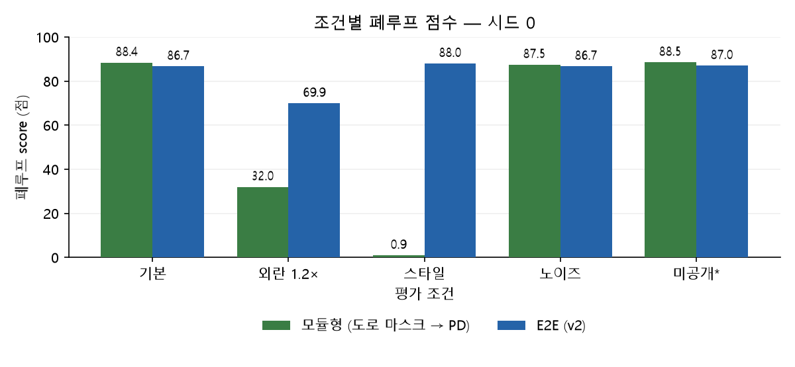

# 비교 리포트 — 202312312 송명진 (8주차)

2026-10-21 실행 · 7주차 v2 모델·데이터 사용 · 전체 모드(`FAST=False`)

## 표 1. 정책 × 조건 폐루프 score (점, 높을수록 좋음)

| 정책 | 기본 (1.0×) | 외란 1.2× | 스타일 변경 | 노이즈 | 미공개* |
|---|---:|---:|---:|---:|---:|
| 모듈형 (도로 마스크 → PD) | 88.4 | 32.0 | 0.9 | 87.5 | 88.5 |
| E2E (v2) | 86.7 | 69.9 | 88.0 | 86.7 | 87.0 |
| E2E + 멀티태스크 (λ=0.5) | 88.7 | — | — | — | — |
| E2E + 프레임 스택 | 88.1 | — | — | — | — |

공개 A/B/C, 시드 0, 트랙당 1회·최대 1,500스텝으로 두 정책에 같은 조건을 적용했고, 관측은 모두 이미지이다.
*미공개 열은 배포 노트북의 랜덤 트랙 101·202 자체 평가이며, ‘—’는 미평가이다.

## 그래프 1. 조건별 비교

## 해석 (5줄 — 한 줄에 한 문장)

1. **어디서 누가 이겼나:** 모듈형은 기본·노이즈·랜덤 트랙에서 각각 88.4·87.5·88.5점으로 앞섰고, E2E는 외란 1.2×·스타일에서 69.9·88.0점으로 앞섰다.
2. **왜 (구조로 설명):** 모듈형의 스타일 0.9점은 고정 도로색 마스크의 오류가 위치·방향 추정과 PD 제어로 전파되는 구조로 설명할 수 있다.
3. **예상과 다른 칸:** 강의자료 19쪽의 예상과 달리 E2E는 스타일 변경에서도 기본 86.7점보다 높은 88.0점을 기록했고, 완주 가능을 예상한 모듈형은 외란 1.2×에서 32.0점으로 하락했다.
4. **내 챌린지 정책에 가져갈 것:** 외란·스타일 조건에서 우세한 E2E를 기본 정책으로 삼고, 고정 색 기준에 대한 의존을 줄이는 설계를 적용하겠다.
5. **다음 실험:** 시드 0·1·2에서 동일 조건을 반복하고, 멀티태스크·프레임 스택도 외란·스타일 조건으로 평가 범위를 넓혀 개선의 일관성을 확인하겠다.

체크: [x] 이미지 관측 · [x] 같은 트랙·외란·시드 · [x] 표에 근거한 해석 · [x] 그래프 축 이름·단위
